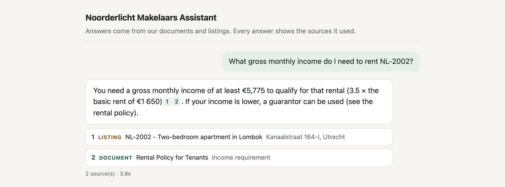
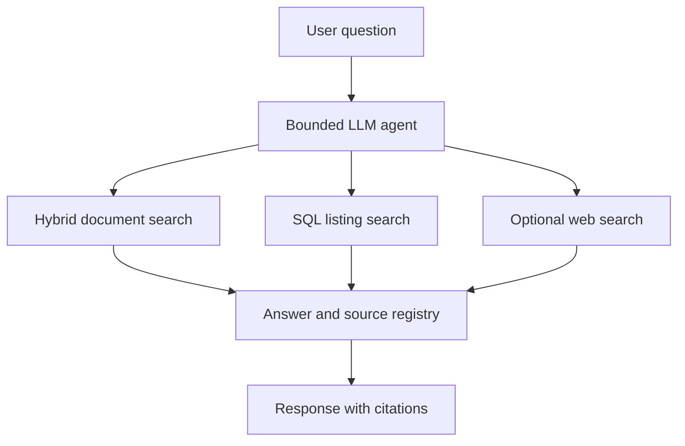

# Real Estate RAG Chatbot

**A source-grounded property assistant that combines company documents, structured property listings, and optional web search.**

I built this portfolio project to explore a practical question: how can a chatbot find the right information, combine different kinds of data, and show where an answer came from? The real-estate setting makes those problems easy to demonstrate, but the retrieval, tool-calling, and evaluation patterns apply to other RAG systems too.

> **Portfolio demo:** Noorderlicht Makelaars is a fictional Dutch real-estate agency. All company documents and property listings are sample data. This is a **local demonstration**, not a production service or a source of real-estate, legal, or financial advice.

## 🎬 Watch the Demo

[](docs/demo.mp4)

**[▶ Play the Full Demo (85 seconds)](docs/demo.mp4)**

[Demo Walkthrough](docs/DEMO.md) ·
[Validation Results](docs/VALIDATION.md) ·
[Evaluation Report](evals/RESULTS.md)

## What it does

- **Answers questions from company documents.** The assistant searches policies and guides, then cites the passages used in its answer.
- **Searches property listings with precise filters.** People can ask for homes by city, price, sale/rent status, bedrooms, pet policy, and features. SQL handles the structured filters; semantic search helps rank free-text preferences.
- **Combines multiple sources.** For example, it can find a rental's monthly price, retrieve the agency's income requirement, and calculate the minimum gross monthly income.
- **Handles missing information.** If the data does not contain an answer, the assistant is instructed to say so rather than invent one.
- **Supports optional external search.** When configured, Tavily can retrieve information from an allowlist of Dutch public-authority websites. External results are labelled separately from company data.
- **Makes retrieval and behavior testable.** The repository includes regression tests, a curated question set, a retrieval-quality gate, and release-validation notes.

The assistant can still make mistakes. A citation shows which source was retrieved; it does **not** prove that every statement is correct or supported by that source.

## Tech stack

| Layer | Tools and techniques |
| --- | --- |
| Backend | Python 3.12–3.13, FastAPI, Pydantic |
| Database | PostgreSQL, pgvector |
| Retrieval | Dense embeddings, PostgreSQL full-text search, Reciprocal Rank Fusion (RRF) |
| Embeddings | FastEmbed, `BAAI/bge-small-en-v1.5` |
| Language model | Groq with `openai/gpt-oss-120b` by default; optional Anthropic provider |
| Optional web search | Tavily, with a configurable domain allowlist |
| Frontend | HTML, CSS, JavaScript |
| Testing and automation | pytest, Node.js test runner, Ruff, GitHub Actions |
| Development and packaging | Docker Compose, uv, locked dependencies |

## How the system works



1. A question enters the FastAPI chat endpoint. The request is checked against local-demo size, rate, and concurrency limits.
2. The model decides which tool to call. Company documents are retrieved using embeddings and full-text search, fused with RRF. Property searches use SQL filters and optional semantic ranking.
3. Tool results are registered as numbered sources, so the UI can display supporting snippets and distinguish documents, listings, and web pages.
4. The model writes an answer. Citation numbers are resolved against the sources actually retrieved for that request.

Tool use is limited to a small number of model rounds and calls. These safeguards keep the demo bounded, but they are not a replacement for production authentication, quotas, or monitoring.

## Demo scenarios

The [recorded video](docs/demo.mp4) shows four examples:

| Scenario | What it demonstrates |
| --- | --- |
| Selling commission | Retrieving and citing a policy document |
| Homes in Utrecht below €500,000 | Applying structured property filters |
| Income needed for rental `NL-2002` | Combining a listing with a policy and calculating an amount |
| Asking for the managing director | Acknowledging that the answer is absent from the dataset |

The video ends with an **explanation** of the optional web-search feature and a **historical** evaluation score. The four app examples were recorded before the current release fixes; they are not a fresh live evaluation of this version. The video is silent and uses fictional data throughout. See [the walkthrough](docs/DEMO.md) for timing and context.

## Run locally with Docker

**Requirements:** Docker with Compose, an internet connection for the initial embedding-model download, and an API key for your chosen language-model provider.

1. Copy the example configuration:

   ```bash
   cp .env.example .env
   ```

2. Open `.env` locally and set `GROQ_API_KEY`. The default provider is Groq. To use Anthropic instead, explicitly set `LLM_PROVIDER=anthropic` and supply `ANTHROPIC_API_KEY`.

3. Start the database, ingestion job, and API:

   ```bash
   docker compose up --build
   ```

4. Open **http://localhost:8000**.

The app loads the sample dataset before serving requests. The API is bound to `127.0.0.1:8000`, and the PostgreSQL container does **not** publish a host port. The demo database password is disposable local configuration; never reuse it on an internet-facing server.

To stop the demo:

```bash
docker compose down
```

`docker compose down -v` also deletes the local database volume. Only use it when you intentionally want to discard that data.

### Updating the sample data

When you change the documents or listings, rebuild and run ingestion deliberately:

```bash
docker compose build
docker compose run --rm ingest
docker compose up -d api
```

Ingestion validates the inputs before connecting to the database. Missing folders, empty datasets, duplicate listing IDs, or malformed listings fail instead of silently wiping the index. An intentional full removal requires existing empty input files and the `--allow-empty` flag.

### Run without Docker

The repository also contains a development helper for a macOS setup with Python 3.12, conda, and PostgreSQL/pgvector:

```bash
cp .env.example .env
scripts/local_db.sh start
# Add your model-provider key to .env before making chat requests.
make ingest
make serve
```

For an existing development database, install from the committed lock file:

```bash
python -m pip install uv==0.13.8
uv sync --frozen --extra dev
# Set DATABASE_URL in .env to your dedicated development database.
uv run --frozen python -m app.ingest
uv run --frozen uvicorn app.main:app --host 127.0.0.1 --port 8000
```

Use a dedicated development database, not one containing data you need to preserve. Node.js 22+ is required for the frontend tests, not for running the browser interface.

## API example

Send a question to `POST /api/chat`:

```json
{
  "message": "What gross monthly income is needed to rent NL-2002?",
  "history": [],
  "allow_web": false
}
```

The response contains an `answer`, a list of resolved `sources`, a `used_web` flag, and `latency_ms`. Each source identifies its kind, title, locator, and supporting preview. The `/api/health` endpoint reports database and configuration status; it does not prove the model provider is currently available.

## Data and evaluation

The repository contains **10 fictional company documents** and **19 fictional property listings**, plus a 30-question evaluation set covering policies, listings, multi-source reasoning, and missing information.

| Check | Recorded result | Important qualification |
| --- | --- | --- |
| Answer regression checks | **28/30** on 14 November 2026 | Historical Groq run, web disabled, **before** the current release fixes; rule-based checks, not general accuracy |
| Document retrieval | **17/17** correct documents in the top five and at rank one | Curated questions from this small dataset, recorded in the 15 November release validation |
| Python tests | **44 passed** in release validation | Includes PostgreSQL integration cases; see [`docs/VALIDATION.md`](docs/VALIDATION.md) |
| Frontend tests | **4 passed** in release validation | Covers bounded conversation history, URL handling, and readable errors |

The updated release has **not** had its full live-model answer evaluation rerun. The original answer text for the historical 28/30 result was not retained, and the automated grader checks phrases and cited source identities rather than proving every answer is true. Web-answer quality is not covered by that score.

### Run the checks

```bash
make lint
make test
make eval-search
```

`make eval-search` requires a running and prepared PostgreSQL database and fails if fewer than 17 expected document-retrieval hits are found. The following optional answer run calls the configured model provider and **may incur charges**:

```bash
uv run --frozen python -m evals.run --workers 1 --min-score 27
```

GitHub Actions runs the non-model checks, including Python and frontend tests, the retrieval threshold, package building, and dependency auditing. The workflow requires no paid model API key. See [release validation](docs/VALIDATION.md) and [the historical evaluation report](evals/RESULTS.md).

## Security, privacy, and scope

This project is designed for **local portfolio use only**:

- The Docker API is exposed on loopback, and the database is reachable only over the private Compose network.
- Model-provider and Tavily API keys belong in the untracked `.env` file, **never** in source code or screenshots. `.env.example` intentionally contains blank key fields.
- Chat requests have local per-process size, rate, and concurrency limits. The model loop has tool and time budgets, and provider calls have explicit timeouts.
- The browser keeps recent conversation turns only in memory. The app does not persist chat messages in an application database, but questions and retrieved passages are sent to the selected model provider. Optional web queries go to Tavily.
- Search-result URLs are checked before being rendered, and web results are restricted to the configured domain allowlist by default.

**Do not use real customer records, personal identifiers, financial documents, or confidential data with this demo.** There is no user authentication, tenant isolation, document-level authorization, or distributed usage quota. A hosted version would need additional security, privacy, monitoring, billing, and deployment work. See [`SECURITY.md`](SECURITY.md).

## Current limitations and future work

- This is a small synthetic dataset, not a benchmark for real-estate question answering.
- Source retrieval and citation formatting do not guarantee factual support or legal correctness.
- The documents are in English; multilingual retrieval has not been evaluated.
- Live web-assisted answers need separate testing against current official sources.
- There is no public hosted demo, user account system, or production-grade abuse protection.

Potential next steps include human-reviewed citation-faithfulness tests, broader evaluation examples, multilingual retrieval tests, and authentication plus quotas before any hosted deployment.

## Project structure

```text
app/       FastAPI app, agent, tools, retrieval, ingestion, and frontend
  data/    Fictional company documents and property listings
docs/      Demo video, screenshot, walkthrough, and release notes
evals/     Curated questions, grading rules, and historical results
tests/     Python, integration, and JavaScript regression tests
scripts/   Local database helper and optional demo recorder
.github/   GitHub Actions workflow and dependency update settings
```

## License

This repository is released under the [MIT License](LICENSE). Third-party libraries and model weights have their own licenses.
